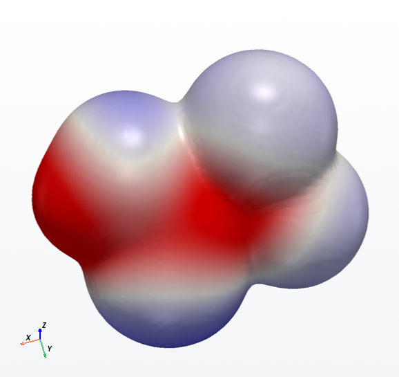

# QuantaBench

**An open, GPU-aware molecular modeling workbench.** Type a name or SMILES, or load a list of
thousands of compounds, and get simulation-ready 3D structures. Along the way QuantaBench assigns
charge states, searches conformers, refines them with machine-learning potentials or tight binding
on your GPU, computes Boltzmann populations and descriptors, and exports for QSAR or molecular
dynamics. Every step is visible in an OVITO-style 3D workspace.

> Status: **0.3 in development, pre-alpha.** The geometry builder pipeline, the 2D/3D viewer, the
> GUI, CLI, surface builder, frequencies and thermochemistry, resumable batch runs and the LAMMPS
> steered-MD bridge work. New in 0.3: CREST conformers, the xtb program, tblite and MOPAC, implicit
> solvents, a Psi4 DFT stage with density/ESP surfaces, an IR spectrum panel and cclib import (tested
> on Linux; the first Windows run of the external programs is pending). GPU paths are written but not
> yet verified on real hardware.
> See [docs/ROADMAP.md](docs/ROADMAP.md) for what comes next and [docs/VISION.md](docs/VISION.md)
> for why this exists.

## What it does today

| Stage | What happens |
|---|---|
| Input | SMILES, InChI, InChIKeys, chemical names or CAS (PubChem); SDF/MOL (V2000, V3000), MOL2, PDB, XYZ, ChemDraw CDX/CDXML, Marvin MRV, CML, CIF, Gaussian/ORCA inputs, SMILES and InChI lists, CSV and Excel lists (CompTox exports: DTXSID, preferred name, SMILES / QSAR-ready / MS-ready fallback); other formats through Open Babel when installed. Spartan-style import options (2D to 3D, hydrogens, data fields, filters, atom order); paste from ChemDraw (CDX, CDXML, MOL) and drag and drop |
| Standardize & protonate | Largest fragment (strips counter-ions, named in the results; metal complexes drawn as ions are refused, not computed without their metal), neutral parent, dominant charge state at your pH, spin from drawn radicals. PFAS-aware: carboxylates, sulfonates and acidic perfluoroalkane sulfonamides are handled |
| Conformer search | RDKit ETKDGv3, MMFF94s pre-optimization, energy window, symmetry-aware RMSD de-duplication; or **CREST** (iMTD-GC metadynamics with GFN2-xTB / GFN-FF) |
| Refinement | **AIMNet2** (ML, ωB97M-D3 quality, neutral and charged), **GFN1/GFN2-xTB** (dxtb, PyTorch; tblite; or the xtb program), **GFN-FF**, **PM7/PM6** (MOPAC), or MMFF94s, optionally in an implicit solvent (ALPB, COSMO). On GPU when available with automatic CPU fallback; on a GPU all conformers of a molecule are optimized in one batch |
| Properties | Boltzmann weights, volume, SASA, radius of gyration, shape, TPSA, CF2/CF3 counts, F/C ratio, charges, dipoles, polarizabilities, HOMO/LUMO, heats of formation and solvation energies from each engine |
| QM (DFT) | **Psi4** single points or optimizations of the lowest conformers at any `functional/basis` (ωB97X-D/def2-SVP, ...), with PCM: dipole, MBIS charges, orbitals, polarizability, frequencies, and density/ESP cubes with 0.002 au volume, area and ESP surface statistics |
| Frequencies | Hessian (exact for xTB, finite differences otherwise), normal modes, IR intensities and spectrum, ZPE / H / S / G (ideal gas, Grimme qRRHO) for the best conformer |
| Export | XYZ, extended XYZ with charges, SDF conformer ensembles, PDB, MOL, LAMMPS data, IR spectrum CSV, batch `summary.csv` and `descriptors.csv` |
| Batches | Resumable: a SQLite job table in the run folder survives crashes and reboots; split a list across machines with `--chunk k/n` and merge the tables |
| Surfaces | AB-stacked graphite and metal slabs; place a molecule at a set gap, grab and turn it with the mouse, overlap check |
| Molecular dynamics | LAMMPS steered-MD setup (adsorbate pulled off a frozen graphite slab), log and pull-force analysis (detachment work, peak force) |
| Viewer | 2D structure (RDKit) and 3D (PyVista) side by side, sharing one atom selection; distance/angle/dihedral readout; element, charge or tag coloring; ESP-mapped surfaces; IR spectrum panel with experimental overlay and normal-mode animation |
| Interop | Import Gaussian, ORCA, Psi4, xtb, MOPAC outputs (cclib) and experimental spectra (CSV, JCAMP-DX) |

## Quick start

One script per OS installs everything (Python 3.12 and git are the only prerequisites). It is safe to
rerun, and `--dry-run` / `-DryRun` shows the steps first. Details and options:
[docs/INSTALL.md](docs/INSTALL.md).

```bash
# macOS (Apple Silicon)
mkdir -p ~/GitHub\ Projects && cd ~/GitHub\ Projects && git clone https://github.com/brandonbtm29/QuantaBench.git && cd QuantaBench && bash scripts/install_macos.sh --with-engines --settings-dir ~/SyncThing/QuantaBench/Settings

# Linux / WSL2
mkdir -p ~/GitHub\ Projects && cd ~/GitHub\ Projects && git clone https://github.com/brandonbtm29/QuantaBench.git && cd QuantaBench && bash scripts/install_linux.sh --with-engines --settings-dir ~/SyncThing/QuantaBench/Settings
```

```powershell
# Windows 11 (PowerShell, in an existing checkout)
cd "$HOME\GitHub Projects\QuantaBench"; git pull; powershell -ExecutionPolicy Bypass -File scripts\install_windows.ps1 -WithEngines -SettingsDir "$HOME\SyncThing\QuantaBench\Settings"
```

Each script installs PyTorch first (Windows and Linux default to the CPU build; `--gpu` / `-Gpu` picks
another), then `pip install -e ".[all,dev]"`. With `--with-engines` it also sets up xtb, CREST, MOPAC and
Psi4 in conda environments. It ends with `quantabench-cli doctor`. Start the app from the Start Menu,
`~/Applications/QuantaBench.app` or the application menu; none of them opens a terminal window. To update,
use Help > Check for updates... or `quantabench-cli update`.

```bash
quantabench                       # the desktop app (from an activated .venv)
quantabench-cli doctor --bench    # what hardware and engines QuantaBench sees, and how fast they are
```

Command line:

```bash
# one molecule by SMILES (with an id), refined with AIMNet2 at pH 7
quantabench-cli build "OC(=O)C(F)(F)C(F)(F)C(F)(F)C(F)(F)C(F)(F)C(F)(F)C(F)(F)F PFOA" --method aimnet2

# a whole list from a CSV with DTXSID and SMILES columns, on the GPU, 12 CPU threads
quantabench-cli build --file cohort.csv --id-col DTXSID --gpu on --threads 12

# a CompTox dashboard export (Excel), split over three machines; this one builds part 2
quantabench-cli build --file pfas_list.xlsx --smiles-pref qsar --method gfn1-xtb --chunk 2/3
quantabench-cli build --resume "~/SyncThing/QuantaBench/Runs/<run folder>"   # after a crash or reboot
quantabench-cli status "<run folder>"
quantabench-cli merge combined/ run_chunk1/ run_chunk2/ run_chunk3/
# Run folders in a SyncThing folder: one machine writes each run folder; `status` only reads it.
# Keep SQLite's transient files out of the sync by adding to that SyncThing folder's .stignore:
#   jobs.sqlite-wal
#   jobs.sqlite-shm

# CREST conformers, GFN2-xTB in water, then a ωB97X-D/def2-SVP stage with density/ESP surfaces (Psi4)
quantabench-cli build "OC(=O)C(F)(F)C(F)(F)C(F)(F)F PFBA" --conformers crest --crest-method gfnff \
    --method xtb-gfn2 --solvent water --optimizer native --qm wb97x-d/def2-svp --cubes

# import another program's output (geometry, energies, charges, frequencies)
quantabench-cli import water_freq.out --out imported/

# frequencies, thermochemistry (ZPE, H, S, G) and an IR spectrum CSV
quantabench-cli freq "OC(=O)C(F)(F)F TFA" --method gfn1-xtb
quantabench-cli build "...PFOA" --freq          # the same as part of a build

# PFOA on a 39 x 38 Å, three-layer graphite slab, ready for LAMMPS, plus a steered-MD folder
quantabench-cli slab --molecule "OC(=O)C(F)(F)C(F)(F)C(F)(F)C(F)(F)C(F)(F)C(F)(F)C(F)(F)F" \
    -o pfoa_graphite.extxyz --lammps-dir pfoa_smd
quantabench-cli md smd --system pfoa_graphite.extxyz -o pfoa_smd_gpu --gpu   # GPU package flags
quantabench-cli md parse pfoa_smd       # after the run: detachment work and peak force
```

`build` uses the resumable job table whenever it builds more than one molecule or gets `--run-dir`,
`--resume` or `--chunk`; a single molecule runs directly. `--batched auto|on|off` controls batched
conformer refinement (auto: only on a GPU).

## Adding molecules

Type a SMILES, name or CAS number in the Molecules box and press Enter, or use File > Open for structure
files and lists. **Edit > Paste** (Ctrl+V) adds what is on the clipboard: a structure copied in ChemDraw
(its own format), a MOL or SD block, CDXML, Marvin, or lines of SMILES and names. The log says which
format was used. In a text field, Ctrl+V pastes text as usual. **Edit > Copy as SMILES / MOL / CDXML**
goes the other way, for the selected molecules (as entered); in ChemDraw, paste with Ctrl+V or Edit >
Paste Special. You can also drop files on the window (a folder opens as a run folder) or drop text on it.

## Importing structures

File > Open and `--file` read SDF/MOL (V2000 and V3000), MOL2, PDB, XYZ, ChemDraw `.cdx` and `.cdxml`,
Marvin `.mrv`, CML, CIF (molecular crystals: one entry per unique molecule), Gaussian `.gjf`/`.com` and ORCA
`.inp` inputs, SMILES and InChI lists (`.smi`, `.inchi`: one per line, an optional id after it), CSV and Excel.
Formats without bonds (XYZ, CIF, Gaussian, ORCA) get them from the geometry, with the charge the file states.
Any other format goes through Open Babel when you have the `obabel` program (on PATH, or set in Settings >
Engines). Open Babel is GPL, so QuantaBench only runs your copy and never ships it. The log says which reader
read each file. The Molecules box also takes `InChI=1S/...` strings and InChIKeys.

When a file has choices, File > Open shows an Import Options dialog like Spartan's SDF Import Options:

- **Fixup:** convert 2D structures to 3D, grow hydrogens, and keep the file's 3D coordinates as the first
  conformer (the build starts from them; with Max conformers 1 it uses only them).
- **Additional data:** post the SD fields or table columns to the molecule list and `summary.csv` (numbers are
  read, units go into the column name), and pick the fields for the id and the name.
- **Filters:** remove water, HCl and other small inorganic molecules, counter-ions, or everything but the largest
  fragment. Each molecule's notes say what was removed. The build's *Keep largest fragment* still applies.
- **Labeling:** atoms in the file's order, or in a standard order (RDKit canonical ranks).
- **Several structures of one constitution:** separate molecules, or conformers of one molecule.

"Don't ask again" keeps the choices; Settings > Import changes them. The command line uses the same stored
choices, and these flags override them:

```bash
quantabench-cli build --file dft_geometries.sdf --keep-coords --no-grow-h --filter water,hcl
quantabench-cli build --file conformers.sdf --same-structures conformers --label-order standard
quantabench-cli build --file set.sdf --import-options "post_fields=true,id_field=CAS_RN"
```

## Workspaces

The activity bar on the left switches between five workspaces, each an arrangement of docks around the
shared 2D/3D view: **Build** (molecules, Appearance), **Calculate** (pipeline, Machines), **Simulate** (surface
builder, LAMMPS export), **Analyze** (the table and its plot, surfaces, spectra, conformers) and **Library** (the
run folders under the output folder: open one, or resume its unfinished molecules). Alt+1 ... Alt+5 switch too
(Control+1 ... on macOS). Each workspace remembers how its docks were arranged; View > Reset layout brings back its
default. The playback bar under the view steps through the selected molecule's conformers, or (its Conformers /
Molecules box) through the molecules of the list.

**Projects** (File > New / Open / Save project, Ctrl+N, Ctrl+Alt+O, Ctrl+S): a `<name>.qbproj` folder holds the
molecule list, the results, the build settings, the Analyze table (columns, formulas, joined files, plot) and the
workspace. Builds in a project write into its `runs/` folder, results that existed only in memory (an imported
output) are written into it when it is saved, and paths inside it are relative, so a project can be moved or synced
to another machine. Opening one is quick (the results are read when a molecule is selected); Build > Resume run
folder continues its unfinished molecules. The title bar marks unsaved changes, and New, Open, Close and Quit ask
about them.

Analyze's **Table** has one row per molecule with its descriptors and summary values (from the run folder's
descriptors.csv and summary.csv, or the molecules built in this session): choose columns, sort, filter, Ctrl+C into
Excel, export CSV or XLSX. **New column...** adds a formula column (`polarizability_bosque_A3 /
molar_volume_packing_cm3`; `+ - * / **`, `log`, `exp`, `sqrt`, ...; columns by the names the column chooser lists),
and **Fit...** fits a formula's parameters to a column, e.g. `((a*alpha + b*mu**2 + c)/Vm)**4` for the quantum
parachor, with n, MAE, RMSE and R². **Features** adds ready-made columns: dimensionless liquid-state groups (the
Lorentz-Lorenz function and refractive index, packing fraction, sphericity, a Lifshitz σ, the reduced surface
tension's unit kT/v_m^⅔), ratios of α, μ, V and A, and the reduced target σ* of any column. **Join...** brings in
columns of a CSV by id (measured surface tensions or densities). **Model...** fits a cross-validated property model
(ridge regression; elastic net, random forest or gradient boosting with scikit-learn) of a column on others, optionally
of σ* with the predictions multiplied back, and joins its predictions to the table. The **Plot** next to it scatters any two columns,
coloured by a third, with a fit line or a 1:1 parity view (MAE, RMSE, bias, R²); clicking a point selects the
molecule.

## Viewer

The center of the window shows the 2D structure (left) and the 3D model (right). Both views share one
selection: an atom picked in either view lights up in both, and the status bar shows the distance,
angle or dihedral of the last 2, 3 or 4 picked atoms. "Show 2D" (Ctrl+D) hides the 2D panel.

**3D view** (Avogadro/PyMOL conventions):

| Mouse / key | Action |
|---|---|
| Left-drag | Rotate the view (trackball) |
| Middle-drag, Shift+left-drag | Pan |
| Wheel, right-drag | Zoom |
| Click an atom | Select it; click empty space to clear |
| Ctrl+click | Add or remove an atom from the selection |
| Double-click an atom | Rotate about that atom from now on |
| R | Reset the view (isometric, fit) |
| X / Y / Z (Shift: from the other side) | Look down an axis |
| P | Perspective / orthographic |
| Esc | Clear the selection |
| Shift+Esc | Cancel a running build (after the current step) |

Toolbar mouse modes: **Rotate** (Ctrl+1, the default), **Select** (Ctrl+2: drag a box) and **Move**
(Ctrl+3: as in Avogadro's manipulate tool, pressing on an atom grabs its whole molecule, or the
adsorbate on a surface; press on a selected atom to grab only the selection. Drag turns the grabbed
atoms rigidly about their center, Shift+drag slides them in the view plane; a click does not change
the selection). Labels: element, index (0-based, as in ASE and RDKit),
element + index, or charge. Colors: element (Jmol), charge (red = negative, white = 0, blue =
positive, on a scale symmetric about zero, as Spartan and Avogadro draw ESP maps), or tag (surface
gray, adsorbate orange).

**2D view:** click selects, Ctrl+click toggles, left-drag on empty space pans, Shift+drag or
right-drag rotates the drawing in-plane, wheel zooms, double-click or F fits, `[` `]` rotate by 15°,
`+` `-` zoom. Hydrogens are implicit by default (View > Hydrogens in 2D). Screenshot... saves the 3D
view as PNG or the 2D structure as SVG/PNG.

**Sketch dock** (Build > Sketch a molecule..., optional): draw a structure in
[Schrödinger's 2D Sketcher](https://github.com/schrodinger/sketcher). **Add to list** adds it like a typed
SMILES; **Replace selected** gives the selected molecule the new structure; **Edit selected** loads the
selected molecule into the sketcher; **Insert fragment** adds a PFAS piece (CF3, a (CF2)n chain, acid head
groups) that you join with a bond. Valence and other structure problems are reported before anything is
added. It needs `pip install -e ".[editor]"`; the editor (17.5 MB) downloads the first time the dock opens
([INSTALL.md](docs/INSTALL.md#optional-extras)).

**Surface builder:** Build & Preview shows the slab in the 3D view; "Move adsorbate" switches to Move
mode so you can orient the molecule by hand. Save and "Export LAMMPS SMD setup..." write the moved
coordinates.

## Using all of your hardware

- **CPU:** one thread setting (default: all logical cores but one) caps RDKit, NumPy/BLAS and PyTorch.
- **GPU:** `auto`, `on` or `off`, a device picker, and a memory cap. AMD Radeon works natively on
  Windows through AMD's ROCm PyTorch wheels, and on Linux through ROCm; NVIDIA works through CUDA.
- `doctor --bench` times a matrix multiply and each engine on CPU and GPU, so you know what runs where.

## Engines

| Engine | Package / program | GPU | Solvent | Notes |
|---|---|---|---|---|
| MMFF94s / UFF | RDKit | no | no | Always available; used for the conformer search |
| GFN1-xTB | dxtb | yes (pure PyTorch) | no | Also provides charges, dipole, polarizability |
| GFN2-xTB | dxtb + tad-libcint | integrals on CPU | no | Linux/WSL |
| GFN2/GFN1-xTB | tblite (pip, Linux/macOS) | no | ALPB, GBSA, CPCM | In process; no libcint needed |
| GFN2/GFN1-xTB, GFN-FF | xtb program | no | ALPB, GBSA | Windows too; its own fast optimizer |
| PM7, PM6-D3H4X | MOPAC | no | COSMO | Heats of formation, POLAR polarizability, COSMO volume |
| AIMNet2 | aimnet | yes* | no | H, B, C, N, O, F, Si, P, S, Cl, As, Se, Br, I. *Some kernels use NVIDIA Warp; AMD may fall back to CPU, which `doctor --bench` will show |
| CREST | crest program | no | ALPB | Conformer search; Linux/macOS, WSL on Windows |
| DFT / HF | Psi4 (own conda env) | no | PCM | QM stage, properties, cubes, frequencies |

The external programs install with conda from [`envs/`](envs); see [docs/ENGINES.md](docs/ENGINES.md)
for versions, pins and pitfalls.

**What the methods mean.** [docs/METHODS.md](docs/METHODS.md) explains each engine, conformer search,
functional, basis set and solvent model: what it is, what it is good and bad at, what it costs, whether it has a
dispersion correction, and what Spartan's B3LYP, ωB97X-D and PM6 numbers are. The same text is under each
pipeline choice in the app (with a "More…" link), in Help > Methods guide... (F1), and on the command line:
`quantabench-cli methods` lists the entries, `quantabench-cli methods wb97x-d` shows one.

**Which method for which molecules.** Before a run, QuantaBench reviews the batch (the elements, charges, PFAS and
functional groups, salts, stereo, radicals), lists the methods that can take it, and recommends settings, each
tied to QuantaBench's own measurements and with a link to the methods guide: the Review window in the app (shown
when you press Run, or Review... / F6), `quantabench-cli review` on the command line, and a short version printed
by `build`. See [docs/CHOOSING_METHODS.md](docs/CHOOSING_METHODS.md).



## Settings

Settings are a single `settings.json`. Point QuantaBench at a synced folder so every computer shares
them:

```bash
quantabench-cli settings --set-dir "~/SyncThing/QuantaBench/Settings"
```

You can do the same from Settings > Folders in the app.

## Platforms

Windows 11 (native), WSL2, Linux and macOS (Apple Silicon) are all targets. macOS is being brought up
now, and several machines (for example a MacBook and a GPU workstation over Tailscale) will be able to
share one project's work. See [docs/PLATFORMS.md](docs/PLATFORMS.md) for what runs where, the
multi-machine plan, and the packages that need upstream fixes or forks.

## Built on

[RDKit](https://www.rdkit.org) · [ASE](https://wiki.fysik.dtu.dk/ase/) · [PyTorch](https://pytorch.org) ·
[dxtb](https://github.com/grimme-lab/dxtb) · [AIMNet2](https://github.com/isayevlab/aimnetcentral) ·
[xtb](https://github.com/grimme-lab/xtb) · [CREST](https://github.com/crest-lab/crest) · [tblite](https://github.com/tblite/tblite) ·
[MOPAC](https://github.com/openmopac/mopac) · [Psi4](https://psicode.org) · [cclib](https://cclib.github.io) · [pyqtgraph](https://www.pyqtgraph.org) ·
[PySide6](https://doc.qt.io/qtforpython-6/) · [PyVista](https://pyvista.org) · optional [OVITO](https://www.ovito.org),
[LAMMPS](https://www.lammps.org) and [Schrödinger's Sketcher](https://github.com/schrodinger/sketcher)

Please cite the underlying methods and programs (GFN-xTB, GFN-FF, CREST, PM7, Psi4, AIMNet2, ETKDG,
MMFF94) when you publish results.

## License

MIT. See [LICENSE](LICENSE). Model weights downloaded at run time carry their own licenses.

Third-party code downloaded at run time keeps its own license too: the optional Sketch dock's editor,
Schrödinger's Sketcher, is BSD-3-Clause ("Copyright (c) 2024, Schrodinger, LLC"; copy in
[src/quantabench/licenses](src/quantabench/licenses/schrodinger-sketcher-LICENSE.txt), and written next to the
downloaded files). Its download also holds Qt for WebAssembly files under Qt's licenses and RDKit (BSD-3).
