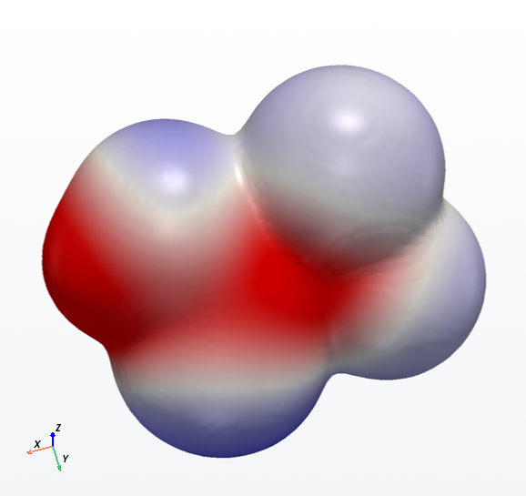

# Engines

QuantaBench computes energies and properties with several engines. The in-process ones (MMFF, dxtb,
AIMNet2, tblite) are Python packages. The external ones (xtb, CREST, MOPAC, Psi4) are separate
programs that run as subprocesses: their OpenMP and BLAS stay out of PyTorch's way, a crash cannot take
the GUI down, a run can be cancelled by killing the process tree, and Linux-only programs can run
through WSL on Windows. `quantabench-cli doctor` lists what it found and where.

| Engine key | What | Family | Runs | Solvent | Windows | Notes |
|---|---|---|---|---|---|---|
| `mmff` | MMFF94s / UFF (RDKit) | force field | in process | none | yes | conformer pre-optimization |
| `gfn1-xtb` | GFN1-xTB (dxtb) | tight binding | in process, CPU/GPU | none | yes | batched on GPU |
| `gfn2-xtb` | GFN2-xTB (dxtb + libcint) | tight binding | in process | none | dxtb fork | PyPI dxtb: Linux/WSL with `tad-libcint<0.4`; fork: all OSes (below) |
| `aimnet2` | AIMNet2 (ωB97M-D3 ML) | ML potential | in process, CPU/GPU (CUDA: stock aimnet; ROCm, MPS: Warp-free `aimnet_torch`) | none | yes | weights download |
| `tblite-gfn2`, `tblite-gfn1` | GFN-xTB (tblite) | tight binding | in process | ALPB, GBSA, CPCM | yes (fork wheel) | GFN2 without libcint |
| `xtb-gfn2`, `xtb-gfn1`, `gfnff` | the xtb program | tight binding / force field | external | ALPB, GBSA | yes | native optimizer |
| `mopac-pm7`, `mopac-pm6` | PM7, PM6-D3H4X (MOPAC) | semi-empirical | external | COSMO | yes | energy = ΔHf |
| CREST | iMTD-GC conformer search | conformers | external | ALPB | via WSL | `--conformers crest`; macOS: the fork build, not conda-forge's (below) |
| Psi4 | DFT/HF QM stage | DFT | external (own env) | PCM | yes | `--qm wb97x-d/def2-svp` |

`method="auto"` tries AIMNet2 > GFN2-xTB (dxtb) > GFN2-xTB (tblite) > GFN2-xTB (xtb) > GFN1-xTB > MMFF,
and with a solvent prefers the engines that can model it. When it passes an installed engine over for a
molecule's elements, the notes say so ("auto: AIMNet2 (ML, wB97M-D3) has no parameters for Sn; using
GFN2-xTB (dxtb + libcint)"), so a batch that mixes levels of theory is visible in `summary.csv`.

## Elements, salts, metals, charge and spin

| Engine | Elements |
|---|---|
| AIMNet2 | H, B, C, N, O, F, Si, P, S, Cl, As, Se, Br, I |
| GFN1/GFN2-xTB (dxtb, tblite, xtb), GFN-FF | H to Rn (Z = 1-86) |
| MMFF94s | organic elements and common ions; **UFF** takes over for the rest (Sn, Hg, hypervalent iodine, B, radicals), noted in the results and in the `forcefield` column |

What the standardization does with research records (every step is in the molecule's notes):

- **Counter-ions.** The largest fragment is kept and the others are named in the notes and in the
  `removed_fragments` column (`[Na+]`, `2 x [Br-]`, a second copy of the parent, a co-crystallized acid).
  Bonds to alkali and alkaline-earth metals are ionic and are disconnected first (`CC(=O)O[Na]` is
  sodium acetate). Turn off *keep largest fragment* to compute the whole record instead.
- **Metal salts.** A bondless Al³⁺, Zn²⁺, Fe²⁺/Fe³⁺ or Cu²⁺ cation (as well as Na⁺, K⁺, Ca²⁺, Mg²⁺,
  Ba²⁺, Sr²⁺) is a counter-ion when the rest of the record is an organic ion and counter-ions: fosetyl-Al
  (`[Al+3]` + 3 ethyl phosphonates) computes one ethyl phosphonate anion, and `removed_fragments` lists
  `[Al+3]` and the two other anions. "An organic ion" means its charge is not on carbon (carboxylate,
  phosphonate, sulfonate, phenolate, ammonium); the other fragments may be metal cations, copies of the
  kept ion, inorganic ions (halide, sulfate, ...), water of hydration or other such organic ions. Al, Fe,
  Cu and Zn bonds drawn in the record are never broken (`standardize.SALT_METALS`).
- **Metal complexes.** A removed fragment that holds any other metal, or a salt metal next to fragments
  that are not counter-ions, fails the molecule with `UnsupportedStructure: metal complex: keeping the
  largest fragment (...) would remove Co (...)`: a neutral ligand (CO, a phosphine, a corrin), a carbanion
  (cyclopentadienide, cyanide) or a neutral kept fragment. A carbonyl complex, a cobalamin or a ferrocene
  drawn as separate ions would otherwise be computed as CO, a bare corrin or cyclopentadiene. The batch
  continues.
- **Organometallics drawn with their bonds** (tributyltin chloride, phenylmercury acetate,
  bis(tributyltin) oxide) are computed whole: bonds to metals other than group 1/2 are kept as drawn
  (RDKit's default metal disconnector would turn R-Hg-OAc into R-Hg+ and TBTO into Bu3Sn+). Conformers
  come from ETKDG + UFF; `auto` refines them with GFN2-xTB.
- **Charge.** With protonation on, the parent is neutralized and protonated for the pH. When the charge
  differs from the record's (`input_charge` column), a note says so: `charge +0 as drawn, -1 computed
  (counter-ions removed, then neutralized and protonated for pH 7)`. Two basic sites within three bonds
  (piperazine, a 1,2-diamine, a guanidine's two NH₂) get one proton, not two; a 1,3-diamine gets two.
  With `--no-protonate` the charge of the kept fragment as drawn goes to the engine unchanged (a −2
  phosphonate is computed at −2, an ammonium at +1; `tests/test_phases.py` checks it from SD records to
  the calculator).
- **Structure keys.** Every row of summary.csv and descriptors.csv has `inchikey` and `canonical_smiles`
  of the computed species (after counter-ion removal and protonation) and `input_inchikey` of the record
  as drawn (all fragments), standard InChIKeys from RDKit. Charge states differ in the last letter
  (`-N` neutral, `-M` one proton removed, `-O` one added), so join on the first 14 characters to match
  an anion to its acid. When InChI cannot represent a species the key is empty and a note says why.
- **Ids from SD files.** `--id-col CAS_RN` uses that SD property; a record without it takes its title
  line as the id (then DTXSID/ID, then `<file>_<record>`), and its notes say so.
- **Spin.** The multiplicity (`multiplicity` column) is 1 for closed shells; radicals drawn in the
  record give the high-spin multiplicity (2 unpaired electrons: triplet) and an odd electron count
  without drawn radicals a doublet, both with a note (radicals in databases are often a missing H or
  charge). An explicit multiplicity that cannot fit the electron count fails the molecule.
- **Not a structure.** R groups, `*` and molfile atom lists (`M  ALS`) fail with "not a definite
  structure".
- **xTB polarizability** of a multiply charged anion in the gas phase can diverge (unbound HOMO); a value
  above 10 ų per heavy atom (or with negative eigenvalues) is discarded with a note.

dxtb's GFN2 and its field properties (xTB polarizability, IR intensities) need the libcint backend.
On Windows and macOS that is the dxtb fork with tad-libcint 0.4 (FORK-1; Linux can use either):

```bash
pip install "dxtb @ git+https://github.com/brandonbtm29/dxtb@qb-v0.4.0.post1" "tad-libcint>=0.4"
```

`engines.libcint_status()` (shown by `quantabench-cli doctor` and the GUI as the reason `gfn2-xtb` is
unavailable) tells a missing tad-libcint from an incompatible one, e.g. tad-libcint 0.4 next to PyPI's
dxtb 0.4 and tad-mctc 0.7. See [INSTALL.md](INSTALL.md#dxtbs-libcint-backend-gfn2-polarizability-ir-intensities).

## Memory guard for dxtb, and the per-molecule time limit

dxtb differentiates through its SCF with its default `scf_mode="full"`: autograd keeps the matrices of every
SCF iteration, so a step's memory grows as (SCF iterations) x nao², where nao is the number of basis functions.
The polarizability (autograd of the dipole with respect to the field) costs about 7x the energy + forces.
In the 325-molecule stress sample this killed four lane processes at 2-3.9 GB. Measured on 2026-11-05 (dxtb 0.4.0,
CPU float64, peak above the ~0.58 GB of a process with torch and dxtb loaded):

| molecule | atoms | nao | charge | GFN1 E+F | GFN1 polarizability | GFN2 E+F | tblite GFN1 polarizability |
|---|---|---|---|---|---|---|---|
| PFOA anion (C8) | 26 | 102 | -1 | 45 MB | 287 MB | | |
| C20 PFCA | 62 | 246 | 0 | 108 MB | 644 MB | | |
| C20 PFCA anion | 62 | 246 | -1 | 237 MB | 1508 MB | | 25 MB |
| Ala10 | 103 | 308 | 0 | 212 MB | 1480 MB | 567 MB | 35 MB |
| Ala10, NH3+ N-terminus | 105 | 312 | +1 | 217 MB | 1551 MB | | |
| Ala15 | 153 | 458 | 0 | 372 MB | | 1522 MB | |
| Ala25 | 253 | 758 | 0 | 920 MB | | | 153 MB |

The full table is in `chem/memory_guard.py`. Charges and the charge dipole without a gradient take 27-122 MB.
Batched refinement (`--batched on`, GPUs) holds B conformers: B x one. Before each dxtb step the pipeline estimates

    MB = k[step] x scf_factor x nao² x conformers + 30

The coefficients are k = 0.0025 for GFN1 energy + forces, 0.0075 for GFN2, 0.016 for the GFN1 polarizability
and 0.0003 for the charges and for tblite's polarizability. They are the upper envelope of the neutral
measurements. `scf_factor` is 1 for a neutral closed-shell molecule, 1.5 for a cation, 2.5 for an anion
(1.7-2.3x was measured), and 6 for an open-shell molecule or one with a transition metal (the SCF can run to
dxtb's 100 iterations). The estimate is compared with the **budget** of the process, minus what the process
already uses. The budget is `resources.memory_budget_gb` (`build --memory-budget GB`). The default 0 means the
memory available when the run starts divided by the number of lanes, and never less than 1.5 GB. A value
below 0 turns the guard off. The run log states the budget.

| step | estimate within the budget | over the budget |
|---|---|---|
| GFN1 charges + dipole (properties step) | dxtb | the whole xTB properties step is skipped, with a note; the molecule stays ok |
| GFN1 polarizability (properties step) | dxtb autograd | **tblite** GFN1-xTB finite field if tblite is installed: the same quantity (Ala10 39.1012 vs 39.1009 ų). A note says so and `xtb_polarizability_method` = `tblite GFN1-xTB finite field`. Without tblite (or if tblite's estimate does not fit either) the polarizability is skipped, with a note. Charges and dipole stay dxtb's |
| dxtb refinement (GFN1/GFN2), sequential | runs | `MemoryGuardError: ... refinement not started by the memory guard: estimated X GB ...`. Method `auto` tries its next engine and notes why. An explicit method fails the molecule with that reason, and the batch goes on |
| dxtb refinement, batched | B conformers at once | batches small enough to fit (the results do not depend on the batch size), and the error above if not even one fits |
| frequencies: analytic dxtb Hessian | autograd Hessian | **central finite differences** of the analytic forces (also with `--freq-hessian analytic`): the same frequencies to ~1 cm-1, at the memory of one energy + forces. A note says so |
| frequencies: finite differences | runs, row by row | the frequencies are skipped with a note (`frequencies skipped (MemoryGuardError: ...)`); the molecule stays ok |
| frequencies: dxtb dipole derivatives (IR) | autograd | the IR intensities are skipped with a note; frequencies and thermochemistry are unaffected |

Every note is in `summary.csv`. dxtb's `scf_mode="implicit"` is not used as a cheaper path. It needs 4-5x less
memory for energy + forces, but its forces differed by 0.83 eV/Å from the full mode on the C20 PFCA anion, and
its polarizability came out 0.

**The frequencies stage** is the largest consumer. dxtb's analytic Hessian differentiates the autograd forces
once more for each of the 3N coordinates, so its memory grows as atoms x nao². Measured 2026-11-05 as above, one
experiment at a time with an RSS watchdog at 2 GB resident (`scratch/hessian_memory.py`; step peak above the
0.64 GB baseline):

| molecule | atoms | nao | charge | GFN1 analytic Hessian | GFN1 finite differences | GFN1 dipole derivatives |
|---|---|---|---|---|---|---|
| TFA anion (C2) | 7 | 28 | -1 | 353 MB, 3.1 s (GFN2: 700 MB) | 21 MB, 3.1 s | 27 MB |
| propane | 11 | 28 | 0 | 465 MB (GFN2: 934 MB) | | |
| C3F8 | 11 | 44 | 0 | 647 MB | | |
| PFBA (C4) | 14 | 54 | 0 | 1042 MB, 7.1 s | | |
| PFBA anion | 13 | 52 | -1 | 1214 MB, 7.1 s | 22 MB, ~7 s | 49 MB |
| Gly-Gly, Ala-Ala, PFPeA anion | 16-23 | 52-68 | | killed above 1.36 GB | | |
| PFOA anion (C8) | 25 | 100 | -1 | > 6.4 GB (killed at 7 GB) | 45 MB, ~21 s | 146 MB |
| PFDoA anion (C12) | 37 | 148 | -1 | | 74 MB, ~40 s | |
| Ala5 | 53 | 158 | 0 | | 135 MB, ~69 s | 240 MB |
| Ala10 | 103 | 308 | 0 | | 271 MB, ~445 s | |

The full table (CF4 to pentane, glycine, alanine, GFN2) is in `chem/memory_guard.py`. Finite differences took
about as long as the analytic Hessian where both ran (one thread), so the guard can be strict. The estimates:

    analytic Hessian   MB = h[method] x scf_factor x atoms x nao² + 250     h = 0.025 (GFN1), 0.08 (GFN2)
    finite differences MB = 2 x k[method] x scf_factor x nao² + 30          (one energy + forces, pool growth)
    dipole derivatives MB = d[method] x scf_factor x nao² + 30              d = 0.009 (GFN1), 0.014 (GFN2)

With a 5 GB lane the GFN1 analytic Hessian is kept up to about the C5 PFCA anion and neutral organics of ~20
atoms. Everything larger takes finite differences. `vibrations.analyze(max_analytic_memory_gb=)` still works as
a cap on the analytic estimate alone, and on a CUDA/ROCm device (dxtb GPU = on) half the free GPU memory is
that cap. The stages that are not handed the run's settings (the Hessian, the embedding) read them from
`resources.set_molecule_limits`, which the lanes, the CLI build, the GUI and grid workers call before the first
molecule.

**Time limit per molecule.** `resources.molecule_timeout_s` (`build --molecule-timeout S`) defaults to 1800 s;
0 turns it off. The slowest molecule of the stress sample that finished took 429 s (a Cr complex in `auto`), so
30 min only ends molecules that are stuck, and a stuck molecule costs at most 30 lane-minutes of a
14,000-molecule batch. QM stages and CREST can take longer per molecule: raise the limit for those runs. A
molecule past the limit is recorded failed with `time limit (1800 s) in <stage>`. This is not a crash, so it is
not tried again in the run; `--retry-failed` (with a higher limit, or 0) redoes it.
- **Lanes:** the parent knows when each lane got its molecule. Past the limit it kills the lane with the
  programs the lane started, records the molecule, and restarts the lane if work is left.
- **One process** (`--lanes 1`, the single-molecule GUI run): best effort. The molecule stops at the pipeline's
  next `should_stop` checkpoint: every optimizer step and conformer, every row of a finite-difference Hessian,
  between stages, and the polls of external programs. A step without a checkpoint (a single dxtb SCF, the xTB
  properties step, an analytic Hessian) runs to its end first. Use lanes when a hard limit matters.
- **Conformer embedding** (RDKit ETKDG has no checkpoint): it gets a quarter of the limit (450 s of 1800 s;
  `conformers.EMBED_TIME_FRACTION`), in one process and in lanes. One conformer is embedded first and timed;
  when the conformers asked for would not fit the time left, fewer are asked for. RDKit's
  `EmbedParameters.timeout` (whole seconds) is the hard stop of every call: a call stopped by it returns a
  single conformer, however many it had finished, hence the timing first. A note says so ("conformer embedding
  limited by the time limit: 120 of 300 conformers (one took 2.9 s, 450 s for the embedding)", or "... stopped
  by the time limit ... after 451 s: 1 of 300 conformers"), and the molecule goes on with what it has. A
  molecule that embeds within the limit gets the same conformers as without it (checked). Measured on a cyclic
  peptide of 102 heavy atoms (199 atoms): ~1.4 s per conformer on one core; with a 60-atom one, 20 conformers
  in 8.1 s, and a 5 s RDKit timeout returned 1 conformer.
- The external-program limit `engines.timeout_s` (one xtb/CREST/MOPAC/Psi4 run) is separate and still applies.

## AIMNet2 and dxtb on GPUs

- **AIMNet2.** aimnet 0.2 computes neighbor lists and D3 dispersion with NVIDIA Warp kernels, which
  run on CUDA and the CPU only. On ROCm (AMD) and MPS (Apple) QuantaBench uses `chem/aimnet_torch.py`
  instead: the same model with the dense neighbor path and D3(BJ) from `tad-dftd3` (the dxtb fork's vendored
  copy, else PyPI's) with aimnet's
  parameters and reference tables. It matches the stock calculator to < 1e-5 eV (CPU and an RX 9060 XT).
  `QUANTABENCH_AIMNET_BACKEND=stock|torch` overrides the choice.
- **"Warp CUDA warning: Could not find or load the NVIDIA CUDA driver".** Warp's C library prints this
  on every process start on machines without an NVIDIA driver, and no Warp setting turns it off.
  QuantaBench initializes Warp itself before aimnet does (`resources.init_warp_quietly`) and drops only
  that line; other Warp messages still show. Verified on Linux; on Windows it depends on Warp's DLL
  sharing Python's C runtime (if the line still shows there, it is harmless).
- **aimnet neighbor-list bug (fixed in QuantaBench, 2026-11-05).** aimnet 0.2's adaptive neighbor list
  shrinks after a small molecule and only grows again on an overflow error that nvalchemiops 0.5 never
  raises. In one process, a larger molecule evaluated after a small one silently lost neighbors (with the
  real weights on NOVA's CPU: PFOA 3.2 eV and PFOS 7.6 eV off). `aimnet_torch.guard_neighbor_lists` makes
  every stock calculator QuantaBench builds check and grow its lists. **Multi-molecule AIMNet2 runs on
  the CPU made before this fix should be re-run.** (The Warp-free GPU path does not use these lists.)
- **dxtb.** `chem/torch_compat.py` runs the dense linear algebra a GPU build lacks (Cholesky and solve
  on AMD's Windows ROCm wheel; everything, in float64, on MPS) on the CPU inside a dxtb call. Results
  match the CPU, but dxtb 0.4 is 5-8x slower on NOVA's GPU than on its CPU (host synchronizations in its
  overlap integrals), so `dxtb_device()` keeps dxtb on the CPU unless Settings > Compute > "dxtb on the
  GPU" (or `QUANTABENCH_DXTB_GPU`) is `on`. `QUANTABENCH_LINALG=auto|cpu|device` chooses what is routed.

## Finding programs

QuantaBench looks, in this order, at: Settings > Engines (a path, or `wsl:/full/path` on Windows),
the `QUANTABENCH_XTB` / `QUANTABENCH_CREST` / `QUANTABENCH_MOPAC` / `QUANTABENCH_PSI4_PYTHON`
environment variables, PATH, the running Python environment, and conda/mamba environments in the usual
places (`~/miniforge3/envs/*`, `~/mambaforge`, `~/miniconda3`, `~/micromamba`, ...).

**Paths per machine.** The settings file is shared by every machine (SyncThing), but a program's path
usually belongs to one: NOVA runs CREST as `wsl:/home/<you>/micromamba/envs/qb-tools/bin/crest`, the Mac
its own build. Settings > Engines and `quantabench-cli settings --engine-path crest=PATH` therefore store
the path for this machine only (`engines.machine_paths`, keyed by the machine name as `dist.machine_lanes`
is); `--machine NAME` sets another machine's, and `crest=` (empty) goes back to finding it automatically
there. `engines.paths` stays the default of every machine (a path that does not exist on a machine, or a
`wsl:` path off Windows, is skipped there). `doctor` names the source: "settings (this machine)" or
"settings". A machine's entry wins over the environment variable, as `engines.paths` always did; to try
another binary for one run, pass `QUANTABENCH_CREST` on a machine without an entry. Saving merges the
per-machine tables with the file as it is then, so a GUI left open on NOVA does not undo the Mac's entry. A QuantaBench from
before this change (0.3.0.dev3 and older) does not know `engines.machine_paths` and drops it when it saves the settings (its GUI saves them at
every Run and on closing): update every machine that shares the file before setting per-machine paths.

Ready-made environments are in [`envs/`](../envs): `tools.yml` (xtb, CREST, MOPAC; Linux/WSL),
`tools-windows.yml` (xtb, MOPAC; Windows) and `psi4.yml` (Psi4 with the pins below). Keep Psi4 in its
own environment.

Each run gets a scratch folder (Settings > Engines > Scratch folder; default `%TEMP%\QuantaBench` or
`/tmp/QuantaBench`). It is deleted on success and kept on failure, and the error message gives its
path. Threads come from the Compute settings; `OMP_STACKSIZE` (default 4G) avoids stack overflows in
xtb and CREST.

## Solvents

`--solvent water` (GUI: Refinement > Solvent) uses one name for every engine: ALPB/GBSA in xtb and
tblite, COSMO (ε) in MOPAC, PCM in Psi4. The 16 names are in `chem/solvents.py` (water, methanol,
ethanol, octanol, acetonitrile, acetone, DMSO, DMF, THF, dichloromethane, chloroform, toluene, benzene,
hexane, diethyl ether, ethyl acetate). Engines without a solvent model run in the gas phase with a note.

Which steps of a run use the solvent (the default model of each engine; summary.csv: `solvent`,
`solvation_model`, and `phase_notes` with one entry per step, e.g. `refine: ALPB(water); ...;
frequencies: ALPB(water)`, or the reason a step ran in the gas phase):

| Step | tblite-gfn2/gfn1 | xtb-gfn2/gfn1, gfnff | MOPAC | dxtb (gfn1/gfn2-xtb), AIMNet2, MMFF |
|---|---|---|---|---|
| Conformer search | RDKit MMFF94s: gas phase in every run (the same pool per phase); CREST: ALPB | same | same | same |
| Refinement | ALPB (GBSA, CPCM on request) | ALPB (GBSA) | COSMO | gas phase |
| Engine properties (dipole, charges, HOMO/LUMO, polarizability, `*_gsolv_kcal`) | ALPB, polarizability included | ALPB (polarizability is D4's α(0)) | COSMO | none |
| xTB properties (`xtb_*`: GFN1-xTB charges, dipole, polarizability) | tblite GFN1-xTB in ALPB | tblite GFN1-xTB in ALPB | tblite GFN1-xTB in ALPB | dxtb, gas phase |
| Frequencies, thermochemistry | ALPB (finite differences of the solvated forces) | ALPB | COSMO (approximate) | gas phase |
| QM stage (Psi4) | PCM where PCMSolver has the solvent | same | same | same |

Without tblite installed, a solvent run takes the xTB properties from dxtb in the gas phase and says so in
the notes and `phase_notes`. In the gas phase the `xtb_*` columns still come from dxtb; dxtb and tblite agree
for GFN1-xTB to 5e-5 e (charges), 1e-4 D and 5e-4 ų, so gas/water differences are the solvent's.

## Phases: the same input in the gas phase and in water

```bash
quantabench-cli build --file cohorts.sdf --id-col CAS_RN --method tblite-gfn2 --no-protonate \
    --max-confs 50 --window 6 --refine-top 5 --freq --phases gas,water --run-dir RUN
quantabench-cli build --phases gas,water --resume RUN      # continue (or add a phase from a sibling's inputs)
quantabench-cli pair RUN/gas RUN/water --out paired.csv    # or `pair RUN`; works on unfinished runs too
```

`--phases` takes any list of solvent names (`gas` = none). Each phase is an ordinary run folder
(`RUN/gas`, `RUN/water`) with its own job table, run one after the other with `--solvent` set to the
phase, so `--resume`, `--retry-failed`, `--lanes`, `--chunk` and the memory guard work per phase, and
`grid build --solvent water` can compute one phase on other machines (then `merge` the chunks and
`pair` them: several folders of one phase are combined). The two phases may also run at the same time
as two plain builds into `RUN/gas` and `RUN/water` with the same settings. At the end `RUN/paired.csv`
is written.

**Pairing** joins molecules by id **and** `input_inchikey` (the input SMILES for older runs), never by row
order. A row whose id matches but whose input structure differs is not paired (`pair_status`: structure
mismatch). Columns: the identity columns once (`id`, `name`, `input_inchikey`, `inchikey`,
`canonical_smiles`, `input_smiles`, `smiles`, `input_charge`, `charge`, `multiplicity`,
`removed_fragments` and the 2D descriptors), `pair_status` (`ok`, or e.g. `water not computed`,
`gas failed`), `pair_notes`, then `dG_solv_kcal`, `dG_solv_G_kcal`, `dG_solv_vertical_kcal`, then for
every other column of summary.csv and descriptors.csv `gas_<col>`, `water_<col>` and, for numeric ones
where a difference means something, `delta_<col>` = water − gas (no delta for counts, timings and flags).
With three or more phases (or `--reference` other than gas) each phase `p` gets `delta_<p>_<col>` and
`dG_solv_<p>_kcal`, relative to the reference phase.

**ΔG_solv.** tblite and the xtb program report, in a named solvent, the total energy of the solute in the
ALPB continuum: the SCF energy of the polarized solute plus the solvation free energy terms (generalized-Born
polar term, a SASA-based cavity/dispersion/solvent-structure term and an empirical shift), in the `gsolv`
reference state (tblite's and xtb's default). That energy already **is** a free energy of solvation on top
of the gas-phase Hamiltonian, so:

- `dG_solv_kcal` = E_water(R_water) − E_gas(R_gas): each phase's best refined conformer at its own geometry
  (`best_energy_eV`), so it includes the conformer and geometry relaxation between the phases: it is the
  vertical value below plus the gas-phase distortion energy E_gas(R_water) − E_gas(R_gas) ≥ 0. Empty, with the
  reason in `pair_notes`, when the methods, charges, multiplicities or computed species differ, when a
  phase failed, or when the water run fell back to the gas phase.
- `dG_solv_G_kcal` = G_water − G_gas when both phases ran frequencies (`vib_gibbs_kcal`: E + ZPE + thermal
  enthalpy − T·S at each phase's own tightly re-optimized minimum; the water Hessian includes the continuum).
- `dG_solv_vertical_kcal` = the water run's `tblite_gfn2_gsolv_kcal` (or `gfn2_gsolv_kcal` for xtb):
  E_water − E_gas at the water geometry, both SCFs self-consistent; the number the xtb program prints as
  Gsolv plus the polarization cost.

All three are for the transfer from 1 mol/L ideal gas to 1 mol/L ideal solution (Ben-Naim's ΔG\*, the
`gsolv` state). The RRHO translational terms are computed at 1 atm in both phases and cancel. For the
1 atm gas → 1 mol/L solution convention add RT ln(24.46) = +1.89 kcal/mol at 298.15 K (tblite's
`bar1mol` state differs from `gsolv` by exactly this, checked numerically). GFN2-xTB/ALPB `dG_solv_kcal`
(vertical): methanol −4.6 (−4.6; experiment −5.1), acetate −67.4 (−68.0), methylammonium −74.4 (−74.5),
methylphosphonate(2−) −238.8 (−240.3) kcal/mol.

The **solvated polarizability** is the finite-field response with the field and ALPB in one SCF; tblite
supports both together, and the dipole-derivative value equals −d²E/dF² of the same calculations to
1e-4 ų (`tests/test_properties_solvent.py`). In water, at the same MMFF geometry, the GFN2 value rises
15-40 % (PFOA and PFOS anions 15 %, 6:2 FTOH 18 %, ethanol 27 %, piperazine 32 %, benzene 42 %) and the
GFN1 `xtb_*` value 8-16 %.

Note that the MMFF94s pre-screen keeps conformers within `--window` + 4 kcal/mol before the `--refine-top`
lowest are refined, and the refined ensemble is pruned to `--window`.

## xtb program (`xtb-gfn2`, `xtb-gfn1`, `gfnff`)

- **Install.** Linux/WSL: `conda install -c conda-forge "xtb>=6.7.1"` (or `envs/tools.yml`). Windows:
  `envs/tools-windows.yml`, or the zip from https://github.com/grimme-lab/xtb/releases; point
  Settings > Engines > xtb at `bin\xtb.exe` if it is not on PATH. xtb ≥ 6.5 is required; 6.7.1 is
  tested. 6.4.x is rejected.
- **Optimizer.** `--optimizer native` uses xtb's own optimizer, 4-10x faster than ASE stepping xtb (one
  extra single point at the end, because `xtbout.json` after `--opt` holds the start geometry's dipole). The
  level is the loosest xtb level whose threshold guarantees the requested fmax (0.03 eV/Å -> `vtight`).
- **Properties.** `gfn2_dipole_debye`, `gfn2_gap_ev`, `gfn2_d4_polarizability_A3` (the D4 dispersion
  model's molecular α(0), a good static-polarizability estimate: water 1.41 vs 1.45 ų experiment),
  and with a solvent `gfn2_gsolv_kcal` (E(solvent) − E(gas) at the same geometry) and
  `gfn2_gsolv_term_kcal` (xtb's printed Gsolv term).
- **Pitfalls.**
  - xtb reports an ion's dipole about its coordinate origin. QuantaBench reports it about the centre of
    mass, which matters for carboxylates and sulfonates at pH 7.
  - xtb writes `.xtboptok` and exits 0 even when an optimization ran out of cycles; QuantaBench reads
    the log instead.

## CREST (`--conformers crest`)

- **Install.**
  - Linux/WSL: `conda install -c conda-forge crest "xtb>=6.7.1"` in one environment (`envs/tools.yml`).
  - Windows: install it inside WSL2 and set NOVA's CREST path to
    `wsl:/home/<you>/miniforge3/envs/qb-tools/bin/crest` (Settings > Engines on NOVA, or
    `quantabench-cli settings --engine-path crest=wsl:/home/...` there: this machine only, see Finding
    programs). The full path is needed because WSL starts it without conda's PATH.
  - macOS (Apple Silicon): **not conda-forge's crest.** Its osx-arm64 3.0.2 cannot optimize molecules of 19
    atoms or more (below). Use the fork's macOS build: `crest-macos-arm64.tar.gz` from `brandonbtm29/crest`
    (branch `qb/macos`, workflow `qb-macos`). Unpack it anywhere, keep `bin/` and `lib/` together, and set it
    as the Mac's path: `quantabench-cli settings --engine-path crest=<folder>/crest-macos-arm64/bin/crest`.
    `scripts/install_macos.sh --with-engines` does this by itself once the build is released
    (`scripts/fork-packages.json`, `macos` > `programs` > `crest`; FORK-5). Keep conda-forge's xtb in
    qb-tools: `gfn2//gfnff` runs it.
- **Levels.** `--crest-method gfn2 | gfnff | gfn2//gfnff | gfn1`; `--quick` is the default
  (`--crest-full` for a full run). gfn2, gfn1 and gfnff run inside CREST 3. `gfn2//gfnff` needs
  CREST's `--legacy` mode (added automatically) and an `xtb` on the PATH CREST sees.
- **Timings, 1-2 threads.** Ethanol gfnff 2 s; CF3COOH gfn2 38 s; PFBA anion gfnff in water 9 s;
  PFBA gfn2 about 2 min. For C8+ PFAS use gfnff and refine with `xtb-gfn2`.
- Conformers whose bonds changed (CREST can find tautomers) are dropped and logged.
- **When CREST fails.** CREST missing, a crash, "Initial geometry optimization failed!", or a stage in which
  no optimization succeeded ("0 of N structures successfully optimized": CREST can print that and still
  exit 0, crest-lab/crest#412). By default (`--crest-fallback rdkit`) the molecule is built with RDKit's
  ETKDGv3 + MMFF94s conformers and flagged:
  - a note with CREST's own reason, the exit code and the kept job folder, also as a WARNING line in the log:
    `CREST conformer search failed (ExternalProgramError: Initial geometry optimization failed! (exit code 1;
    job files in /tmp/QuantaBench/crest_x1)); used RDKit ETKDGv3 + MMFF94s instead`;
  - `summary.csv`: `conformer_search` = `rdkit` and `conformer_fallback` = the reason (empty when the
    conformers are CREST's);
  - at the end of the batch, "WARNING: CREST failed for N of M molecule(s) ..." with the first ten; the
    count is also in `quantabench-cli status`, in the GUI's run summary ("N ok with RDKit conformers because
    CREST failed") and on its status bar.
  - `--crest-fallback fail` (GUI: untick "If CREST fails, use RDKit's conformers") marks those molecules
    failed instead (`ConformerSearchError: ...`), so `--retry-failed` redoes them once CREST works.
- **conda-forge's osx-arm64 CREST 3.0.2** (build `hb2118c8_1`, diagnosed 2026-11-06 on the M3 Max, macOS
  27.2; details in the fork's `docs/MACOS.md`):
  1. It links Apple's Accelerate directly instead of conda's OpenBLAS (CMake's FindBLAS takes Accelerate when
     no `BLA_VENDOR` is set). Accelerate's classic BLAS keeps the f2c convention: a REAL function returns a
     double, so CREST's `real(sp) :: sdot` reads garbage (3.7e19 for 569.8). ANCOPT's rational-function step
     uses that `sdot` in its Davidson solver when nvar + 1 >= 50, i.e. from 19 atoms. So every initial
     optimization of 19+ atoms fails, and smaller molecules pass. The same binary relinked to conda's
     OpenBLAS (`install_name_tool`) works.
  2. libgfortran 16 (in the same environment) rejects ANCOPT's format `'(1x,"("f7.2"%)")'` ("Missing comma
     between descriptors"), so `crest --opt` stops after cycle 0 with exit code 2. This hits any platform
     with a gfortran >= 15 runtime; the fork adds the commas (11 formats).
  The first Mac benchmark (2026-11-06) ran with it. 18 of 20 molecules fell back to RDKit, flagged only by a
  note at the time.
- **The fork's macOS build on the MacBook** (CI run 42295799792; table in the fork's `docs/MACOS.md`). On PFBA⁻,
  PFHxA and PFOA⁻ every mode runs: single point, `--opt`, iMTD-GC with `--gfn2`, `--gfnff` and `--alpb water`,
  `--quick`, `--gfn2//gfnff` (legacy, conda-forge's xtb 6.7.1), `--cregen`, `--protonate`, `--deprotonate`,
  `--tautomerize`, `--thermo`, `--entropy` and QCG with 3 waters. Energies match conda-forge's linux-64 3.0.2
  (NOVA's WSL build) to 1e-8 to 2e-5 Eh, and `--thermo` on the same frequencies is identical. That Linux
  build itself stops in `--opt` and QCG with the libgfortran 16 format error; QuantaBench's runs use neither.
  The Mac is 5-9x faster than 2 Linux cores in iMTD-GC (12 threads), but slower in legacy mode and
  `--tautomerize`.
- **The 20-molecule benchmark again, with the fork build** (2026-11-06, `Runs/crest-2026-11-06/mac-fixed`; the
  first run's flags `--method tblite-gfn2 --window 6 --refine-top 5 --no-protonate`, `--lanes auto` = 6 lanes x 2
  threads; against NOVA's WSL, conda-forge's linux-64 3.0.2 with 20 lanes x 2 threads):

  | GFN-FF | Mac, fork build | NOVA, WSL |
  |---|---|---|
  | gas: molecules with CREST conformers | 20/20 (conda-forge's Mac build: 2/20) | 20/20 |
  | gas: wall; CREST stage summed; slowest molecule | 3,108 s; 8,961 s; 3,079 s | 1,247 s; 5,038 s; 1,195 s |
  | water: molecules with CREST conformers; wall | 20/20; 5,222 s (4,337 s awake: the Mac slept 15 min) | 20/20; 5,982 s |

  - The searches agree as well as two CREST runs do: the same lowest conformer for 15 of 20 molecules in the gas
    phase (`conformers compare`, common level GFN2-xTB opt; the other 5 are sampling, missed both ways), best
    refined energies within 0.1 kcal/mol for 12 of 20 (median difference -0.005 kcal/mol). In water the large
    anions differ by -5 to +12 kcal/mol (Mac minus NOVA; sampling, lower on either side).
  - Wall time on the Mac is set by its slowest molecule on 2 threads (54950-05-9, 54 heavy atoms: 51 min in the
    gas phase) while the other lanes are idle. CREST per molecule took about 1.8x NOVA's time summed over the 20.
  - Water dipoles of CREST's lowest conformer against Spartan's (B3LYP/6-311+G** C-PCM at Spartan's lowest;
    the 10 ions with the largest errors of the 2026-11-06 validation): MAE 8.6 D (Mac) and 7.3 D (NOVA), against
    13.0 D with RDKit's conformers. Neither run has Spartan's lowest conformer of any of the 10: GFN2/ALPB at
    Spartan's geometry is 0.40 D from Spartan's dipole, so the conformer is 95 % of the gap. For 7 of the 10
    GFN2/ALPB itself puts Spartan's conformer above CREST's (the energy model ranks, not the search: VAL-3).
  - GFN2 on the Mac (CREST `--gfn2`, 6 lanes x 2 threads, 3 h limit per molecule; finished 2026-11-07): gas 16/20 in
    20,034 s, water 15/20 in 21,603 s. All 9 failures are the time limit, on the largest molecules (92340-26-6,
    54950-05-9, 67940-02-7, 61119-62-8, and 57589-85-2 in water). NOVA's 30 min limit had stopped all 10 ions in
    water. Their dipoles and conformers are not compared yet.
  - Lane timing, GFN-FF gas, same 20 molecules (2026-11-07, M3 Max: 10 performance + 4 efficiency cores):

    | Lanes x threads | 1 x 12 | 3 x 4 | 5 x 2 | 6 x 2 (`--lanes auto`) |
    |---|---|---|---|---|
    | wall | 1,727 s | **773 s** | 1,457 s | 3,108 s |

    3 x 4 is 4.0x faster than today's auto plan and faster than NOVA's WSL run (1,247 s, 20 x 2). Two threads
    per lane leave the largest molecule as the last one running, on 2 threads; 12 threads on one molecule scale
    poorly. One run each, so the ranking is clear but the exact factors are not.

## tblite (`tblite-gfn2`, `tblite-gfn1`)

- **Install.** Linux/macOS: `pip install tblite` (part of the `xtb` extra). Windows: PyPI has no wheel,
  so the `xtb` extra skips tblite there. Install the wheels from Brandon's fork (FORK-2) into the venv:

  ```powershell
  pip install tblite --only-binary tblite --find-links https://github.com/brandonbtm29/tblite/releases/expanded_assets/qb-v0.8.0-win1
  ```

  They are tblite 0.8.0 for CPython 3.11-3.13 (win_amd64), built in GitHub Actions
  ([workflow](https://github.com/brandonbtm29/tblite/blob/qb/windows-wheels/.github/workflows/qb-windows-wheels.yml))
  with MSYS2's MinGW-w64 gfortran, OpenMP and ddX (CPCM). The only change to upstream is in a build file
  (`config/meson.build` also links the GFortran runtime on Windows). delvewheel bundles the GCC runtime
  and reference BLAS/LAPACK DLLs, the same BLAS as the PyPI Linux wheel. On BTM NOVA they reproduce
  the Linux wheel's water energies (GFN2, GFN1, ALPB, GBSA, CPCM) to 1e-14 Eh, and
  `tests/test_eng_tblite.py` passes. This is not an official tblite release: drop it once upstream
  ships Windows wheels. conda-forge's `tblite-python` works too, but only if QuantaBench runs in that
  conda environment, and its win-64 build has no ddX, so no CPCM.
- Matches the xtb program to 4e-9 Eh. Solvation: ALPB (default), GBSA (falls back to ALPB where GBSA
  lacks parameters), CPCM (ε).
- **Polarizability.** `tblite_gfn2_polarizability_iso_A3` is the electronic response from finite fields
  (6 SCFs), in the run's solvent when it has one (see Phases above). The minimal basis makes it about a
  third of experiment (water 0.37 vs 1.45 ų): use it for trends.
- **Solvation energy.** With a solvent, `tblite_gfn2_gsolv_kcal` = E(solvent) − E(gas) at the best
  conformer (one more SCF) and `tblite_gfn2_solvation` names the model used (`ALPB(water)`).
- Threads: OpenMP reads `OMP_NUM_THREADS` when tblite is first imported. QuantaBench sets it at startup.

## MOPAC (`mopac-pm7`, `mopac-pm6`)

- **Install.** `conda install -c conda-forge mopac` (Windows: `Library\bin\mopac.exe`) or the
  installer from https://openmopac.net. MOPAC ≥ 22 (open source, no license key); 23.2.5 tested.
- **Energy is the heat of formation in eV**, because MOPAC's gradients are those of ΔHf. Compare
  energies only within one method. ΔHf already includes ZPE and 298 K thermal terms, so after frequencies
  use the corrections (`vib_zpe_kcal`, `vib_h_corr_kcal`, `vib_g_corr_kcal`), not the absolute H and G.
- `--optimizer native` (MOPAC's own optimizer) is 3-15x faster than ASE stepping MOPAC.
- **Properties.** `pm7_heat_of_formation_kcal`, dipole, HOMO/LUMO/gap, ionization energy,
  `pm7_polarizability_iso_A3` (POLAR, closed shell; water 1.26, methanol 2.99 ų) and, with COSMO,
  `pm7_cosmo_area_A2` and `pm7_cosmo_volume_A3`.
- MOPAC exits with code 0 on errors; QuantaBench reads its error messages instead.
- **COSMO is not smooth:** energies and gradients jump as surface segments switch. Optimizations in COSMO
  can stop short of fmax, and COSMO frequencies are approximate (CF3COO⁻ in water: a −28 cm⁻¹ spurious
  mode). Run MOPAC frequencies in the gas phase.

## Psi4 (QM stage)

```
quantabench-cli build "OC(=O)C(F)(F)C(F)(F)C(F)(F)F PFBA" --method xtb-gfn2 --solvent water \
    --conformers crest --crest-method gfnff --qm wb97x-d/def2-svp --cubes
```

- **Install** in its own environment: `conda env create -f envs/psi4.yml`. Then set Settings > Engines
  > Psi4 Python to that environment's `python` (`QUANTABENCH_PSI4_PYTHON` works too). Without it,
  QuantaBench looks for a `psi4` launcher in the usual places.
- **Levels** are `method/basis`: `wb97x-d/def2-svp` (Spartan's ωB97X-D; dispersion built in),
  `b3lyp-d3bj/def2-tzvp`, `hf/6-31g*`. Use `def2-svpd` (diffuse functions) for anions where it matters.
- **What the stage does** for the `qm_top` lowest conformers: a single point or an optimization (optking).
  For the best one, optionally:
  - properties: dipole about the centre of mass, quadrupole, Mulliken/Löwdin/MBIS charges, HOMO/LUMO;
  - the static polarizability: analytic CPSCF for HF/LDA/GGA/hybrids including ωB97X-D; finite field for
    meta-GGAs, VV10, double hybrids and PCM;
  - density and ESP cubes with surface descriptors;
  - frequencies with IR intensities and qRRHO thermochemistry, computed with QuantaBench's own
    vibrational code.
- **Descriptors.** `qm_energy_ev`, `qm_dipole_debye`, `qm_homo_ev`, `qm_lumo_ev`, `qm_gap_ev`,
  `qm_polarizability_iso_A3`, `qm_mbis_*`, `qm_zpe_kcal`, ..., `qm_surf_*`.
- **Files.** `<id>_qm_log.out`, `<id>_qm_density.cube`, `<id>_qm_esp.cube`, `<id>_qm_geometry.xyz`
  and the QM IR spectrum, written next to the other results.
- **Timings, 2 CPU threads, ωB97X-D/def2-SVP.** Water 1 s. PFBA anion in PCM water: SCF 31 s,
  properties 21 s, cubes 23 s, finite-field polarizability 142 s (PCM forces finite fields).
- **Pitfalls.**
  - PCM solvents: PCMSolver has no DMF, n-hexane, diethyl ether, octanol or ethyl acetate; those QM stages
    run in the gas phase with a note.
  - libint 2.13 makes Psi4 1.9.1 segfault: pin `libint=2.9`.
  - Cubes need density fitting: with `scf_type pk` (exact integrals, a `psi4_options` override) Psi4 1.9.1's
    ESP cube fails ("Bad BraKet type in Libint2TwoElectronInt"). The driver's default `df` changes ωB97X-D/6-31G*
    energies by 0.03-0.3 kcal/mol and dipoles by under 0.001 D. For exact integrals use `direct`: `pk` keeps
    N⁴/8 integrals on disk when they do not fit in memory (about 12 GB at 330 basis functions).
  - pint ≥ 0.25 breaks qcelemental 0.30, so every optimization fails: pin `pint<0.25`. The driver
    patches this for its own process and warns.
  - `-d3bj`/`-d4` functionals need `dftd3-python` / `dftd4-python`.
  - PCM has no analytic gradients in Psi4: optimizations and frequencies run in the gas phase;
    energies and properties are PCM single points (noted).
  - DFT frequencies by finite differences cost 2(3N−6)+1 gradients (≈145 for PFOA).

## Surfaces (Surfaces panel, `qm_surf_*` descriptors)

From the QM density and ESP cubes: the 0.002 au density isosurface (area, enclosed volume) with the ESP
mapped on it, and the Murray-Politzer GIPF statistics: V_min, V_max, means, σ²₊, σ²₋, σ²_tot, ν, Π.
Without QM cubes, the panel draws a vdW or solvent-accessible surface colored by the point-charge ESP
of the current conformer's charges. Colors follow Spartan and GaussView (red = negative). Water at
ωB97X-D/def2-SVP: 20.5 ų and 36.8 Ų at 0.002 au.

The descriptors use the 0.002 au surface (Spartan's), recorded as `qm_surf_iso_au`. Published
Murray-Politzer GIPF values are on 0.001 au, where the ESP is softer (water HF/6-31G*: σ²tot 345 vs 478
(kcal/mol)² at 0.002 au), so compare with the literature only at the same isovalue.



## Importing other programs' results

`quantabench-cli import FILE...` and File > Import calculation output read Gaussian, ORCA, Psi4, xtb,
MOPAC and other outputs through cclib (`pip install cclib`, the `interop` extra). Geometries, energies,
charges, frequencies and IR intensities become a built molecule; the Spectra panel shows and animates
its modes. Experimental spectra (CSV, JCAMP-DX including compressed forms) can be overlaid.

### Spartan documents (`.spartan`)

Spartan '24 documents go through the same command and menu item, but all documents given become **one
table**: one row per molecule and document, keyed by the molecule label (the CAS number in the PFAS QSAR
batches), so a project split into many documents needs no manual recombination:

```bash
quantabench-cli import batches/*.spartan --table all.csv --sdf all.sdf     # --conformers all: one row each
quantabench-cli import cohorts/*/*.spartan --table all.csv --wide qsar.csv # + one row per label, all levels
```

- Documents from Spartan for Windows (gzipped `Input.gz`, `PropertyArchive.gz`) and for macOS (the same
  streams uncompressed) both read. A molecule that cannot be read is counted under a named reason (no Input
  stream, Input not readable, no geometry in Input) and listed; nothing is skipped silently.
- Every row has `source_file`, `molecule_index` (position in its document), `storage` (`M0001`), `label` and
  `duplicate_label` (1 when the molecule's own label occurs in more than one molecule; nothing is overwritten),
  then `label_resolved`, `label_source`, `label_note`, `structure_key`, `inchikey`, `canonical_smiles`,
  `structure_charge`, `charge_check`, the level of theory (`spartan_version`, `spartan_task`, `spartan_method`,
  `spartan_basis`, `spartan_solvent`, `spartan_solvent_raw`, `spartan_status`), `formula`, `smiles`,
  `n_atoms`, `charge`, `multiplicity`, `n_conformers`, and every scalar Spartan property as `spartan_<name>`.
- QuantaBench columns, from quantum-chemical calculations only (units checked against Spartan's output, its
  manual and identities between the archive's values): `homo_ev`, `lumo_ev`, `gap_ev` (Spartan: hartree),
  `dipole_debye`, `zpe_kcal`, `h_corr_kcal` (H - E), `g_corr_kcal` (G - E), `entropy_cal_molK`. CPK area and
  volume, ovality, the ESP areas, Spartan's estimated polarizability, hardness, electronegativity, logP and
  the energies (a heat of formation for PM6, a total energy for DFT) stay `spartan_*`; their units are in
  `chem/io_spartan.py`. In this long table a PM6 and a DFT HOMO are both `homo_ev`, told apart by
  `spartan_method` next to them.
- **Est. Density Functional single points** (`SOPT DLXD2XV`, e.g. the conformers a multi-step conformer search
  writes out) run a ωB97X-D/6-31G* SCF and then a neural-network energy (`POSTENERGY`). They have no
  `DIPOLE_MAG`: `dipole_debye` is the SCF's dipole (`QM_DIPOLE`, debye) and `qm_dipole_level` names the SCF
  (`WB97X-D/6-31G(d)`, Spartan's `SPENERGYAT`); `spartan_spenergy` is its total energy (hartree). Neutral
  molecules only; a conformer search's own `QM_DIPOLE` is not mapped (it belongs to the Input geometry).
- **Labels.** Spartan keeps a molecule's label (the CAS number in the PFAS QSAR batches) only in the document
  it was built in; extracted conformers and the PM6/DFT documents made from them say `M0003` or `M0001[2]`,
  the documents a multi-step conformer search writes its conformers to `Molecule1`, `Molecule41`, ...
  Those rows are joined to their base document (`C1B_P5_SemiEmp_PM6.spartan` -> `C1B_P5.spartan`, which must
  be among the inputs) by structure: elements, connectivity and charge must match exactly one label there.
  `label_source` is `input`, `structure`, `ambiguous` (several base labels share the structure, e.g. an anion
  under the CAS numbers of its salts; `label_note` lists them) or `unresolved` (no base document, or the
  structure is not in it). Nothing is guessed.
- **Structure keys** QuantaBench can match: `inchikey` and `canonical_smiles` of the structure as Spartan drew
  it (its bonds and bond orders, formal charges from each atom's bond-order sum: a one-bond carboxylate O is
  O⁻, a quaternary N is N⁺; R/S and E/Z from the geometry), computed by the same function as QuantaBench's own
  species (`chem.validate.species_keys`). `structure_charge` is the drawing's charge and `charge_check` says
  whether Spartan calculated with it (`ok`) or not (`mismatch`: e.g. a quaternary ammonium calculated as -1,
  a phosphate dianion as -1; their Spartan values are not the drawn ion's).
- `spartan_solvent` is QuantaBench's solvent name (`WASSER` -> `water`); `spartan_solvent_raw` and the level
  text keep Spartan's keyword.
- **`--wide`** writes one row per resolved label with each level of theory's best result (completed first,
  then lowest energy: the conformer energy, `E_KCAL`, `POSTENERGY` for Est. DFT jobs, `OPTENERGY`) as prefixed
  columns: `conf_*` (conformer search), `mm_*`, `pm6_*`, `dft_*`, ... plus
  `<prefix>_level`, `<prefix>_n_rows` (e.g. conformers at that level) and `<prefix>_n_failed`. The prefix
  comes from the method and task, not the document name; when a run has two levels with one prefix, each
  gets its level appended (`conf_dlff03`, `conf_mmff`), so a column never mixes levels. The command prints
  the prefixes it used. An **ambiguous structure** gets one row of its own keyed by its structure:
  `label_resolved` empty, `label_source` = ambiguous, `cas_candidates` = the CAS numbers it could be
  (`;`-separated). Comparing a QuantaBench run with this table: [VALIDATION.md](VALIDATION.md).
- Conformer libraries (conformer searches): `n_conformers` and the lowest-energy saved conformer's values
  (`spartan_conf_energy_kcal`, `spartan_conf_boltzmann_weight`, ...; Spartan's kcal/mol).
- Geometry: the `Input` coordinates. After a Spartan optimization (PM6 `OPT`) these are still the starting
  geometry (the optimized one is not read yet); such rows say so in `spartan_notes`.
- `--sdf` writes the reported geometries (bonds from Spartan) with the label and source columns, ready for a
  QuantaBench run; per-atom Spartan values (e.g. MMFF charges) are SDF atom properties.
- Documents are read molecule by molecule (olefile, pure Python), so memory stays flat (the staged sample of
  7 documents, 2,750 molecules, 102 MB: 10 s on 2 cores, under 200 MB).
- In the GUI, every molecule of a document becomes one result with its saved conformers ranked.

## PubChem (`quantabench-cli pubchem`)

`chem/pubchem.py` is a PUG REST + PUG View client; `pubchem enrich` runs it over a molecule list:

```
quantabench-cli pubchem enrich cas_list.csv --out enriched.csv                       # CAS and/or SMILES columns
quantabench-cli pubchem enrich RUN_DIR --validate --experimental --out enriched.csv --records experimental.csv
quantabench-cli pubchem enrich cas_list.csv --offline --out enriched.csv            # from the cache only
quantabench-cli pubchem lookup 335-67-1 --experimental                              # one identifier
```

- **Input:** a CSV/Excel table, an SD file, or a QuantaBench run folder or merged tables (`summary.csv`, or a
  phases folder's `paired.csv`). A molecule is looked up by its CID column, else its CAS RN (`--id-col`, a CAS
  column, or an id/name that is a valid CAS RN), else the InChIKey as drawn, the SMILES, the name or DTXSID. A
  CAS RN with several CIDs keeps the ones that list it as a registry number (xrefs RN).
- **Output:** one row per molecule, the input's columns then `pubchem_*`:
  - `pubchem_status` and `pubchem_query`;
  - `pubchem_cid` and `pubchem_cids`, plus the CID's title;
  - `pubchem_cas` (the first CAS RN among the synonyms, check digit verified), `pubchem_cas_all`, and
    `pubchem_cas_in_xrefs`;
  - formula, molecular weight and exact mass, SMILES and connectivity SMILES, InChI and InChIKey;
  - XLogP, TPSA, complexity, H-bond donor and acceptor counts, rotatable bonds, charge, heavy atoms.

  PubChem renamed CanonicalSMILES/IsomericSMILES to ConnectivitySMILES/SMILES in 2025, and a request for the
  old names now returns only the new ones; the client asks for the new names and reads the old ones too.
- **`--validate`** compares QuantaBench's structure with PubChem's for the molecule's CAS RN by standard InChIKey:
  - `match`;
  - `stereo_differs`;
  - `charge_or_protonation_differs` (same first block, or a salt and its parent);
  - `component_of_mixture` (PubChem's record has several components and QuantaBench's structure is one; the
    note names the others and says when QuantaBench kept a smaller component than the largest);
  - `different_structure`;
  - `cas_not_in_pubchem`;
  - `ambiguous_cas`;
  - `no_cas` or `no_structure` where there is nothing to compare.

  QuantaBench's structure is the input as drawn (`input_inchikey`) and the computed species (`inchikey`), and
  the better agreement counts.
- **`--experimental`** fetches each CID's PUG View "Experimental Properties" (one request) and keeps surface
  tension, density, boiling and melting points, vapor pressure, viscosity, solubility, logP, pKa, refractive
  index, heat of vaporization, critical constants and the physical description as records. Each record has:
  - the raw string and the parsed value (ranges, ±);
  - the unit and the value in a standard unit (surface tension in mN/m; dyn/cm = mN/m, N/m x 1000);
  - the temperature, the source and its id, the reference with its DOI, and the URL;
  - a condition class for the liquid properties: `pure_liquid`, `aqueous_solution` (with the concentration)
    or `unknown` (+ `needs_review`). The class comes from the text, the reference (CRC Handbook, Jasper, Yaws,
    DIPPR: pure; surfactant literature: likely aqueous) and the melting point: a compound that is solid at the
    temperature gives no pure-liquid value there.

  The row gets a summary: the best pure-liquid surface tension near 25 °C, the lowest aqueous one, a liquid
  density, mp, bp and the parachor M σ^¼/ρ. `--records FILE` writes every record in long form. Why the two
  kinds of surface tension must be kept apart, and the source survey, are in docs/SURFACE_TENSION.md.
- **Usage policy:** at most 5 requests/s and 400/min (`--rate`, default 4/s). The client reads
  `X-Throttling-Control` and spaces requests out when a status is Yellow (x2; x1.5 for the service status) or
  Red (x4; x2 for the service), and pauses 60 s on Black. It retries 503/504 with backoff (2-32 s). The
  User-Agent is `QuantaBench/<version> (+https://github.com/brandonbtm29/QuantaBench)`, with no email.
  Requests are batched where PUG REST allows: properties 100 CIDs a request, synonyms and registry numbers 50.
- **Cache:** every answer (200, 404, 400) goes into one SQLite file, by default the per-machine cache folder
  (`QUANTABENCH_CACHE_DIR/pubchem/pubchem_cache.sqlite`; `--cache DIR` elsewhere). An interrupted run (Ctrl+C,
  network loss: it stops after 10 failures in a row) resumes from where it stopped when run again, and
  `--offline` never touches the network. Keep the cache out of SyncThing unless only one machine writes it.
- **Requests for a list of N molecules** with an empty cache: about N lookups + N/100 + 2·N/50 batches, plus N
  PUG View records with `--experimental`. For 14,000 CAS RNs that is about 14,700 requests (1 h at 4/s) without
  `--experimental` and 28,700 (2 h) with it, while PubChem reports Green; up to 4x longer under Red.
- `chem.inputs.lookup_name` (names typed in the GUI or CLI) goes through the same client, so its lookups are
  rate-limited and cached too.

## Not available yet

- NMR shieldings (Psi4 has none; planned through PySCF).
- Orbital isosurfaces (cubes of selected MOs) and local ionization potential maps.
- CREST on native Windows without WSL.
